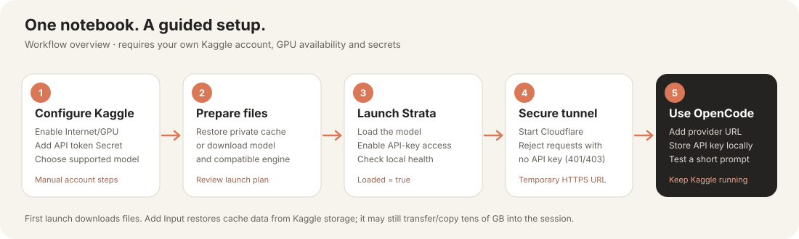
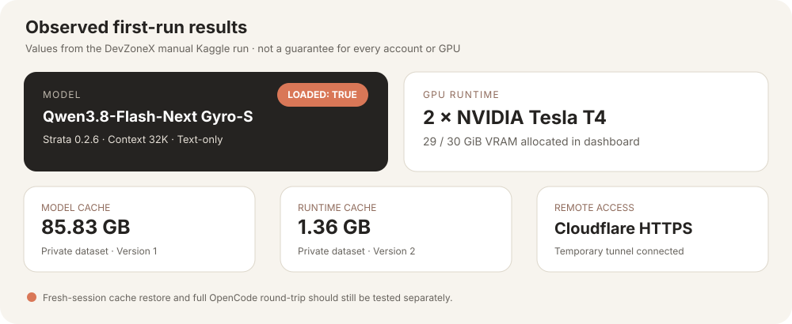

# 🚀 Strata on Kaggle — by DevZoneX

[](https://github.com/iAmAjayTeli/devzonex-strata-kaggle/actions/workflows/tests.yml)
[](LICENSE)


[](https://kaggle.com/kernels/welcome?src=https://github.com/iAmAjayTeli/devzonex-strata-kaggle/blob/main/notebooks/Strata_Kaggle_Launcher.ipynb)

**Run a Strata-supported model on a Kaggle GPU, cache the model and Strata runtime in your own private Kaggle Datasets, and connect OpenCode Desktop through a temporary authenticated HTTPS tunnel.**

This project turns our Strata + Qwen3.8-Flash-Next Gyro-S setup into a guided notebook. The default example is `gyro / gyro-s`; other choices must be supported by the installed Strata release.

> [!WARNING]
> **Experimental project.** The complete first-run and fresh-session workflow still needs validation on more Kaggle accounts and GPU configurations. Review the Strata launch plan before approving large downloads. Kaggle availability, quotas, GPU types, model licenses, and Strata compatibility vary.

## ✨ What it does

| Stage | What happens |
|---|---|
| **1 · Preflight** | Checks Kaggle Secrets, GPU visibility, Internet, attached datasets, and Strata version. |
| **2 · Choose a model** | Select a Strata-supported family/variant, context, vision option, and GPU list. |
| **3 · Restore or install** | Restores your private caches when attached; otherwise installs Strata and lets it fetch compatible files. |
| **4 · Review plan** | Streams Strata's plan output into the notebook so you can review compatibility before downloading large files. |
| **5 · Start securely** | Streams Strata launch logs into the notebook, starts Cloudflare access mode, and creates/reuses a temporary Quick Tunnel. |
| **6 · Verify** | Checks API-key enforcement, model listing, health, and a short authenticated generation. |
| **7 · Cache** | Optionally uploads model files and the Strata terminal/engine into separate private datasets you own. |
| **8 · OpenCode** | Prints the temporary HTTPS base URL, model ID, and provider configuration snippet. |
| **9 · Optional supervision** | Runs a six-hour health-monitoring cell that checks Strata and the tunnel authentication boundary. |

## 🧭 Quick links

[](https://kaggle.com/kernels/welcome?src=https://github.com/iAmAjayTeli/devzonex-strata-kaggle/blob/main/notebooks/Strata_Kaggle_Launcher.ipynb)

If the badge does not open the notebook import flow, go to [Kaggle Notebooks](https://www.kaggle.com/notebooks/welcome), choose **Load from URL**, and paste:

```text
https://github.com/iAmAjayTeli/devzonex-strata-kaggle/blob/main/notebooks/Strata_Kaggle_Launcher.ipynb
```

Opening the notebook imports its code; it does **not** grant access to anyone else's private datasets or secrets.

- **[Open the Kaggle launcher notebook](notebooks/Strata_Kaggle_Launcher.ipynb)**
- [Kaggle setup checklist](docs/kaggle-setup.md)
- [OpenCode connection guide](docs/opencode-setup.md)
- [Troubleshooting](docs/troubleshooting.md)
- [Security policy](SECURITY.md)
- [Strata official setup guide](https://github.com/Niko1221/Strata/blob/main/docs/AI_SETUP.md)
- [Strata model compatibility](https://github.com/Niko1221/Strata/blob/main/docs/MODELS.md)

---

## 🗺️ Visual walkthrough





These are **workflow/results illustrations**, not raw UI screenshots. The screenshots shared during setup were used to ground the run summary below.

## ✅ Verification status

### Manually observed as working

- **First launch:** Strata reported `Strata is serving` for `qwen3.8-flash-next-gyro-gyro-s`; the local health endpoint reported `"loaded": true`.
- **Hardware:** the dashboard showed two Tesla T4 GPUs with approximately 29 GiB / 30 GiB VRAM allocated.
- **Remote tunnel and API security:** Cloudflare Quick Tunnel connected; the public API rejected a request without a key, and the authenticated API test succeeded.
- **Model cache upload:** Kaggle showed a private Version 1 model dataset of approximately 85.83 GB with the model and support files.
- **Runtime cache upload:** Kaggle showed a private Version 2 runtime dataset of approximately 1.36 GB with the archive, checksum, and manifest.
- **Fresh-session restore and OpenCode:** the maintainer reports that, after attaching the private model/runtime datasets in a fresh Kaggle run, Strata launched and OpenCode connected and returned responses successfully.
- **Live progress:** Strata launch and Kaggle upload helpers have been updated to stream command output and periodically print status when a process is quiet.

### Still to validate across more environments

The main end-to-end workflow has been manually verified for the default `gyro / gyro-s` setup. The full six-hour monitoring period has not yet been confirmed to complete uninterrupted, and other model families, GPU types, Strata versions, and Kaggle account configurations need separate tests. The project remains experimental for those broader environments.

## ✅ Before you start

You need:

- A Kaggle account, Internet access, and an available compatible GPU accelerator.
- A Kaggle API token stored as a notebook Secret.
- Your exact Kaggle username.
- Enough session time, local disk space, and dataset quota for the model and supporting files.
- A model whose license permits downloading and use. To cache it, the license must also allow a private copy.
- OpenCode Desktop if you want to use the model through OpenCode on Windows.

### Model compatibility matters

This is **not** a universal Hugging Face model runner. Strata supports particular families, variants, formats, and hardware combinations. A model being downloadable does not mean Strata can run it. Use the official Strata compatibility list and inspect the launch plan before proceeding.

The default tested example is:

```python
MODEL_FAMILY = "gyro"
MODEL_VARIANT = "gyro-s"
CONTEXT = "32k"
VISION = "off"
```

Start with text-only mode.

---

# 🧑‍💻 First-time setup — full walkthrough

## 1. Open the notebook in Kaggle

1. Open [`notebooks/Strata_Kaggle_Launcher.ipynb`](notebooks/Strata_Kaggle_Launcher.ipynb) on GitHub.
2. Download the `.ipynb` file and use Kaggle's notebook import flow, or create a blank notebook and copy the cells in order.
3. Enable **Internet** and select an available NVIDIA GPU accelerator.
4. If Kaggle requests a restart after changing settings, restart the notebook before running any cells.

GPU availability, session length, and quotas depend on Kaggle's current policies and your account.

## 2. Add Kaggle API credentials as a Secret

1. Create an API token using Kaggle's current account settings.
2. In the notebook, open **Add-ons → Secrets**.
3. Create a secret named exactly `KAGGLE_API_TOKEN`.
4. Paste the token into the secret value and enable access for this notebook.
5. Never put the token in a code cell, output, GitHub file, screenshot, or chat.

The notebook reads the token through Kaggle's `UserSecretsClient` and stores it in a restricted temporary config path for CLI commands.

## 3. Configure the model and your cache names

In the **USER CONFIGURATION** cell, edit at least:

```python
KAGGLE_USERNAME = "your-kaggle-username"
MODEL_FAMILY = "gyro"
MODEL_VARIANT = "gyro-s"
CONTEXT = "32k"
VISION = "off"
GPU_IDS = ""  # blank = auto-detect visible GPUs
MODEL_DATA_DIR = "/root/strata-local"

# "symlink" avoids an extra local 80-GiB copy; mounted reads can be slower.
# Use "copy" if launch/loading from the Kaggle input mount is too slow.
MODEL_RESTORE_MODE = "symlink"

UPLOAD_CACHES = True
I_CONFIRM_MODEL_LICENSE_AND_PRIVATE_STORAGE = False
FORCE_UPDATE_MODEL_CACHE = False
FORCE_UPDATE_RUNTIME_CACHE = False
```

**Replace the placeholder Kaggle username.** Dataset names are derived from your configured username and model family/variant.

By default the notebook plans to use these separate datasets:

- `<your-username>/strata-model-<family>-<variant>`
- `<your-username>/strata-runtime-cache`

These are user-owned caches, not global datasets shared by the project owner. Attach only datasets you own or have been granted access to.

### Confirm the model license before caching

Keep `I_CONFIRM_MODEL_LICENSE_AND_PRIVATE_STORAGE = False` until you have checked that the model's license/terms permit making and storing a private copy in Kaggle. If the flag remains false, the model upload is skipped. Do not upload model weights to GitHub.

## 4. Run the notebook cells in order

1. **Load helpers and credentials** — clones the repository's scripts and reads your Kaggle Secret.
2. **Restore caches or install Strata** — uses attached private datasets when available; installs Strata if not.
3. **Review plan** — inspect Strata's plan and confirm the selected model, engine, context, and GPU setup before downloading.
4. **Launch Strata** — fetches missing compatible model/engine files on a first run.
5. **Tunnel and health check** — checks local health and API-key protection, starts a Quick Tunnel if Strata hasn't provided a URL, and verifies the public endpoint.
6. **Authenticated generation test** — confirms chat completions work.
7. **Upload private caches** — stores the model and runtime separately, if enabled and permitted.
8. **Print OpenCode config** — provides the current URL/model/provider snippet.

Before the endpoint is considered ready, the checks should establish:

- `/health` reports the model loaded and API-key protection enabled.
- An unauthenticated `/v1/models` request returns `401` or `403`.
- An authenticated model listing succeeds.
- An authenticated `/v1/chat/completions` request returns text.

If an unauthenticated public request succeeds with HTTP `200`, stop the tunnel and fix authentication before continuing.

## 5. Wait for private dataset processing

| Cache dataset | What's saved | Purpose |
|---|---|---|
| Model cache | Model weights/support files plus path-and-size manifest | Avoid re-downloading model assets from their original source |
| Runtime cache | Strata terminal, engine components, manifest/checksum, and optionally Cloudflare Tunnel binary | Avoid re-downloading the same compatible runtime build |

The notebook creates datasets without a public-visibility flag. Verify each dataset's visibility and file list on Kaggle. “Upload successful” means the files transferred; it does not necessarily mean Kaggle finished processing the dataset.

Large uploads may be rejected due to account limits, disk space, network issues, or model license terms.

---

# ⏱️ Keep Strata running for six hours

After the launch, tunnel, and authenticated API test succeed, the notebook contains an **optional six-hour supervision cell**. Run it when you want to keep the notebook actively monitoring the actual service. It checks:

- the local Strata health response,
- that the model remains loaded and API-key protected,
- periodically, that the public URL still rejects no-key requests.

This is a genuine health monitor, not a fake mouse/keyboard keepalive. It does **not** override Kaggle's session or GPU quota limits and cannot guarantee uptime. Kaggle's published docs list up to 12 hours for CPU/GPU notebook executions and a shorter time for TPU sessions; limits can change. Stop the monitor when you finish.

For long executions, Kaggle's **Save Version → Save & Run All** workflow can run in the background until the platform's runtime cap. However, the full notebook must finish or reach its monitoring cell within the permitted session, and you must be able to retrieve the emitted tunnel URL. Do not treat a free notebook as an always-on production server.

---

# 🔁 Restore on a later Kaggle session

1. Reopen the notebook and enable Internet/GPU.
2. Use **Add Input** to attach your own model and runtime cache datasets.
3. Enable the `KAGGLE_API_TOKEN` Secret for this notebook.
4. Keep the model family/variant and username consistent with your cache names.
5. Run the notebook from top to bottom.

The model dataset uses a `manifest.json`; the runtime dataset contains `strata-runtime-cache.bin`, `strata-runtime-cache.bin.sha256`, and `runtime-manifest.json`.

The notebook verifies the manifest and file sizes, then uses the `MODEL_RESTORE_MODE` option:

- `"symlink"` (recommended when avoiding the *second* 80-GiB copy): creates links in `/root/strata-local` to the attached read-only Kaggle dataset. This avoids copying those bytes to local storage again, but model loading or reads can be slower because the files are on the input mount.
- `"copy"`: copies the model files into local storage. It takes extra time and disk space, but usually gives Strata faster local file access. This is the fallback if symlink mode launches too slowly or has I/O problems.

**Why Add Input can still show a download progress bar:** Kaggle must make the selected dataset files available to the fresh runtime; this is a transfer from your Kaggle Dataset storage into that notebook session, not the same as downloading the model again from its original model host. No notebook option can eliminate this input-staging step.

With `MODEL_RESTORE_MODE = "symlink"` (the notebook default), the helper creates links under `/root/strata-local` to the attached read-only `/kaggle/input` files, avoiding a second full 80-GiB copy. Reading the model from the mount may be slower. With `MODEL_RESTORE_MODE = "copy"`, the helper copies the files into local storage, using extra time and disk space but often improving local-read performance. In either mode, wait for Kaggle's input staging and the restore cell to finish before launching Strata. The goal is to avoid downloading the model from its original host again—not to eliminate every transfer.

Runtime caches may not be compatible after a Strata, engine, OS, CUDA, or GPU change. Review the plan again and allow Strata to fetch a compatible component when needed.

---

# 🖥️ Connect OpenCode Desktop

1. Copy the **current** HTTPS URL printed by the notebook.
2. In the Kaggle shell, retrieve the API key privately with `strata launch --show-key`. Do not include it in notebook output or chat.
3. On Windows, save it locally as `%USERPROFILE%\.config\opencode\strata-key.txt`.
4. Merge the printed provider snippet into the existing top-level `providers` object in `opencode.jsonc`. Don't overwrite other provider or MCP settings.
5. Set the model to the provider/model ID printed by the notebook, restart OpenCode, and test in a fresh session.

Keep the Kaggle runtime and tunnel running while using OpenCode. Quick Tunnel URLs are temporary, public URLs, and can change on restart. Anyone who obtains a URL can reach the endpoint, so API-key enforcement is required. Update the OpenCode base URL after every tunnel change.

---

## 🔐 Security and licensing

- Never commit API tokens, local OpenCode keys, Kaggle credentials, model weights, runtime archives, or saved notebook outputs containing secrets.
- Keep model/runtime datasets private and check their visibility in the Kaggle UI.
- Verify API-key protection before using a public tunnel; stop the tunnel if the no-key request isn't rejected.
- Stop Strata and Cloudflare when you're finished. This is temporary experimental hosting, not production infrastructure.
- Check the model terms before making a private cache copy.
- The repository's MIT license applies only to the original project code/docs; third-party software and model files retain their own licenses.

## 🛠️ Troubleshooting

| Problem | What to check |
|---|---|
| No GPU | Enable the accelerator and restart if requested; check `nvidia-smi`. |
| Secret missing | Confirm `KAGGLE_API_TOKEN` spelling and notebook access. Never print the value. |
| Dataset missing | Attach it through Add Input and verify username/slug. |
| Kaggle API 403 | Check token/account/ownership and whether dataset processing has completed; don't immediately repeat a 1+ GB upload. |
| Model unsupported | Choose a family/variant supported by the installed Strata release; review the launch plan. |
| Launch cell shows only the first status line | The launch helper used by an already-running cell may buffer output until Strata exits. The latest helper streams logs and progress live; the notebook's helper-load cell now pulls the latest repository version and reloads the module. Rerun that cell before starting a new launch. 
| Cache upload shows only “Preparing … files” | The currently running notebook may still have the older helper imported, which buffers Kaggle CLI output. Don't interrupt an active upload. The latest helper streams Kaggle upload progress and emits a 30-second heartbeat if the CLI is silent; rerun the helper-load cell before another cache upload. |
| Model download slow | Check local disk space, network, model size, and remaining session time. |
| Cache upload skipped | Check the explicit model-license confirmation and upload logs. |
| Runtime cache fails with `Text file busy` | A Strata Python executable is still in use while restoring. Rerun the helper-loading cell to get the latest version; it reuses a matching installed runtime or stops Strata and extracts to staging before replacing files. Then rerun the restore cell. |
| Tunnel unavailable | Confirm local health, `cloudflared` is running, and the URL is current. |
| OpenCode 401 | Check the local key file and provider config without printing the key. |
| OpenCode hangs | Test authenticated `/v1/models` and `/v1/chat/completions`, inspect logs, and check model context limits. |

## 🧪 Development and tests

Run the helper tests locally:

```bash
python -m pip install --upgrade pytest
python -m compileall -q scripts tests
python -m pytest -q
```

Unit tests do not replace a clean Kaggle integration test. Validate first run, private uploads, fresh-session restore, no-key rejection, authenticated generation, six-hour monitoring, and OpenCode connectivity.

## 🤝 Contributing

Please report the Strata version, GPU, whether it was first run or cache restore, and the error with secrets removed. Never attach model files, credentials, or sensitive notebook output to issues.

## 📄 License

Original project code and documentation: [MIT](LICENSE). Third-party components and models retain their respective licenses.
